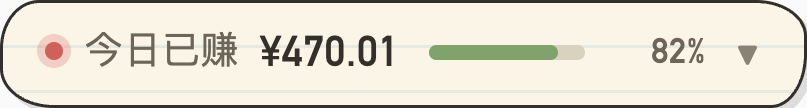
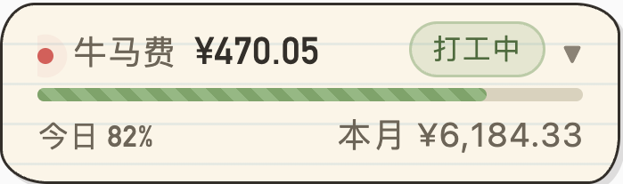
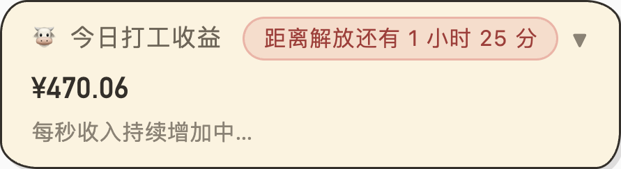
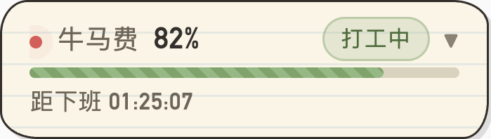
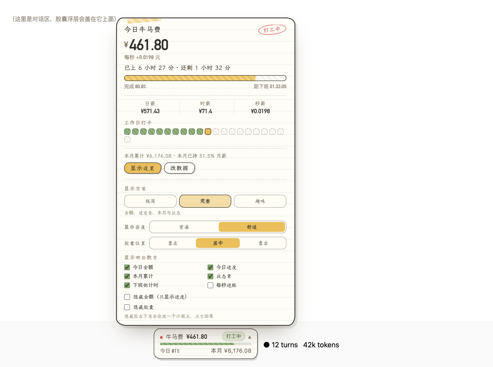

# dsh-niuma-timer · 牛马费用计时器

DeepSeek Harness（DSH）插件：在输入框下方挂一张手帐风格的小卡，实时显示**今天已经挣到多少牛马费**、**本月累计多少**，附带日薪 / 时薪 / 秒薪、当日进度条、下班倒计时与本月工作日打卡点阵。

## 界面

收起态是一枚可配置的**迷你仪表盘**，三种显示方案任选：

| 方案 | 长什么样 |
|---|---|
| **A · 极简** | 一行：`● 今日已赚 ¥398.55 ▬▬▬ 80%` —— 金额、细进度条、百分比 |
| **B · 完整** | 两行：`牛马费 ¥398.55` + 状态章；下方手绘进度条，底部「今日 80% …… 本月 ¥6,174」 |
| **C · 趣味** | `🐮 今日打工收益` + `距离解放还有 1 小时 34 分` 红章；金额换行放大，底部一句「每秒收入持续增加中…」 |

三种方案都遵守同一条横向预算：胶囊按内容占宽、不抢原生 `activity` / `usage` 统计胶囊的位置，宽度不够时整行自然换行，任一方都不会被裁掉。

展开态（点击胶囊）是手帐卡片：今日金额大字、每秒进账、已上/还剩、手绘进度条、日薪/时薪/秒薪三格、工作日打卡点阵、本月累计与月薪进度。卡片是**半透明浮层**（`position: fixed` + `backdrop-filter` 磨砂），从胶囊处向上浮起、盖在对话区之上，**不占布局空间**：输入框和对话列的高度、位置都不会因为展开而变化。

## 显示设置

展开卡片里点「显示设置」，可以改这些（改完立即生效，存在 `localStorage`）：

| 设置 | 说明 |
|---|---|
| 显示方案 | 极简 / 完整 / 趣味三选一 |
| 显示密度 | 紧凑（字号降一档、收起次要行）/ 舒适 |
| 胶囊位置 | 靠左 / 居中 / 靠右（只改胶囊自己在 dock 里的对齐，不动宿主容器） |
| 显示哪些数字 | 今日金额、今日进度、本月累计、状态章、下班倒计时、每秒进账，六个独立开关 |
| 隐藏金额 | 勾上后所有金额与本月累计都不显示，主位交回进度百分比——适合在共享屏幕时用 |
| 隐藏胶囊 | 一键把胶囊收掉，右下角留一个半透明小圆点（🐮），点它恢复 |

「改数据」里是计算口径相关的：月薪（到手）、上班、下班、午休开始、午休时长、本月应出勤天数（0 = 按周一到周五自动算）。

状态章会自动切换：**打工中 / 午休中 / 已下班 / 无偿加班 / 未开工 / 休息日**；下班后仍在工位时，卡片显示「白干 X 小时 X 分」，金额封顶不再增长。

## 截图

| A · 极简 | B · 完整 | C · 趣味 |
|---|---|---|
|  |  |  |

| 隐藏金额 | 显示设置 |
|---|---|
|  |  |

## 计算口径

```
净工作秒数 = (下班 − 上班) − 午休时长
日薪       = 月薪 ÷ 应出勤天数
今日已挣   = 日薪 × 已工作秒数 ÷ 净工作秒数
本月累计   = 已完成工作日 × 日薪 + 今日已挣（不超过月薪）
```

工作日默认按周一到周五自动识别；法定节假日、调休请把「本月应出勤天数」填成实际值（非 0 即视为手动）。

## 数据存放

配置写在页面 `localStorage` 的 `dsh-niuma-timer.v1` 键下，不经过 Host、不上传。清空方式：卡片内改成默认值再保存，或在开发者工具里删除该键。


## 安装

插件是一个标准的 DSH bundle（`dsh.bundle.patch` + `dsh.client`），四种装法任选其一：

**0. 从 npm 安装（装好即用）**

```bash
dsh plugin --profile desktop add dsh-niuma-timer
```

装完刷新页面即可看到胶囊，不需要重启 Harness。

**1. 让 DSH 内的 Agent 安装（推荐）**

对 Harness 说：把 `/绝对路径/dsh-niuma-timer` 作为 bundle 安装（Agent 会调用 `plugin_manager` 的 `install_bundle`）。

**2. 命令行**

```bash
# macOS 自带 CLI 在 App 内部，二选一
"/Applications/DeepSeek Harness.app/Contents/Resources/runtime/cli/bin/dsh" plugin --profile desktop add /绝对路径/dsh-niuma-timer

# 或已把 dsh 加入 PATH 时
dsh plugin --profile desktop add /绝对路径/dsh-niuma-timer
```

装完后确认 profile 的 `dsh.profile.bundles` 里出现 `dsh-niuma-timer`，再重启 Harness。

**3. 插件管理面板**

设置 → 插件 → 安装本地目录，选中本目录。

装好后在任意会话的输入框下方即可看到那枚小胶囊；改动只在本地 profile 生效，重启后依然存在。

## 卸载

`dsh plugin --profile desktop remove dsh-niuma-timer`（或插件管理面板里停用 / 移除），并从 profile 的 `dsh.profile.bundles` 中去掉该行。

## 开发与打包

源码即产物，没有构建步骤：`npm pack` 出来的 tarball 就是发布内容。

- `npm pack` 前先确认 `package.json` 的 `version` 已递增；
- 本地联调可用 `dsh plugin --profile desktop add /绝对路径/dsh-niuma-timer`（走 `link:`，改完刷新即生效）；
- 用 tarball 预检：`dsh plugin --profile desktop add "file:/绝对路径/dsh-niuma-timer-1.1.0.tgz"`。

## 实现说明

- Host 半（`index.js`）只有 `export function apply() {}`：插件是纯客户端渲染，无工具、无事件、无后台任务。
- Client 半（`client.js`）走 `window.__ModuleLoader__` 模块表，`inject: ['slots']`，注册到 `conversation.composer.dock`（`order: 60`）。
- 不 import 任何 Harness Client 包，只取 shell 模块表里的 `react`（`react-dom` 仅用于可选的门户，缺失时自动回退为原地渲染）；样式通过 `ctx.effect` 注入 `<style data-dsh-niuma-timer>`，卸载时自动移除。
- 展开面板用 `ReactDOM.createPortal` 挂到 `document.body` 下的 `.nt-layer`，位置由胶囊的 `getBoundingClientRect()` 实时换算成 CSS 变量（左/宽/上/最大高/尾巴位置），`resize` 与 `scroll` 时重算；`Esc`、点击面板外部都会收起。dock 里始终只有收起态胶囊，所以展开不会改变任何布局尺寸。
- 字体：内嵌霞鹜文楷（LXGW WenKai，SIL OFL 1.1）的 246 字子集（woff2，34KB），只用于本插件容器，不污染宿主 UI。
- 容器与控件颜色为纸感固定色（浅色纸 + 深墨字），在浅色/深色主题下都保持可读；焦点态回落到宿主 `--dsw-alias-brand-primary`。
- 文案中英双语，跟随 DSH 语言设置，回落到 `<html lang>`。

## 已知边界

- 只统计「今天」与「本月」，不做历史账单、不做多份工作、不处理跨零点夜班。
- 金额按到手月薪折算，税前/五险一金差异请自行调整月薪数值。
